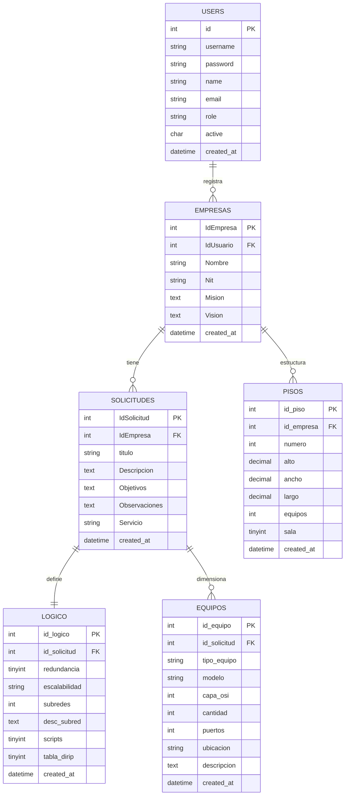

# Universidad Distrital - LDWS (LAN Design Workspace System)

[](https://github.com/KevinAndrey96/ldws-ud/actions)
[](https://phalcon.io/)
[](https://www.php.net/)
[](https://mariadb.org/)
[]()
[](https://www.udistrital.edu.co/)

**Proyecto de Grado:** *Modelo para el Diseno de Redes en Entornos LAN Basado en un Sistema Multinivel.*
Desarrollado en la **Universidad Distrital Francisco Jose de Caldas** (Bogota D.C., Colombia) dentro de la Facultad de Ingenieria para optar al titulo profesional en Ingenieria.

LDWS es una plataforma web de ingenieria construida sobre el framework de alto rendimiento **Phalcon PHP**, concebida como una herramienta de apoyo a la metodologia formal **Top-Down Network Design** (Priscilla Oppenheimer / estandar Cisco) para el diseno, dimensionamiento fisico, estructuracion logica y generacion automatizada de configuraciones de redes de area local (LAN) en edificaciones corporativas multinivel.

---

## Fundamentos de la Metodologia Top-Down

El enfoque tradicional de diseno de redes suele incurrir en el error de seleccionar equipamiento o topologias fisicas de forma intuitiva sin antes caracterizar los requerimientos de la organizacion. La metodologia **Top-Down** divide el ciclo de vida del diseno en cuatro fases secuenciales:

```
+-------------------------------------------------------------------------------+
| FASE 1: ANALISIS DE REQUERIMIENTOS Y METAS DE NEGOCIO                        |
| - Registro organizacional: Mision, Vision y contexto empresarial             |
| - Solicitud de diseno: Objetivos, alcance y catalogo de servicios criticos    |
|   (Web, Bases de Datos, VoIP con QoS, Video, Active Directory, Correo, DMZ)   |
+---------------------------------------+---------------------------------------+
                                        |
                                        v
+-------------------------------------------------------------------------------+
| FASE 2: DISENO FISICO DE INFRAESTRUCTURA (SISTEMA MULTINIVEL)                |
| - Dimensionamiento por plantas: Largo, ancho, altura y puestos de trabajo     |
| - Asignacion jerarquica de cuartos de telecomunicaciones:                    |
|   * Piso 1 / Planta Baja: Main Distribution Frame (MDF)                       |
|   * Pisos Superiores: Intermediate Distribution Frame (IDF)                   |
| - Calculo de cableado estructurado horizontal UTP Cat 6 (Norma TIA/EIA-568-C) |
| - Estimacion de Access Points Wi-Fi por densidad y cobertura de radiofrecuencia|
+---------------------------------------+---------------------------------------+
                                        |
                                        v
+-------------------------------------------------------------------------------+
| FASE 3: DISENO LOGICO, SEGMENTACION Y ALTA DISPONIBILIDAD                    |
| - Esquema de direccionamiento IP con VLSM (Variable Length Subnet Masking)   |
| - Segmentacion por VLANs: Datos, VoIP, Servidores, Gestion y Red Invitados    |
| - Redundancia de Primer Salto: Protocolo HSRP (Hot Standby Router Protocol)   |
| - Prevencion de bucles en conmutacion: Rapid-PVST+ (Spanning Tree Protocol)  |
+---------------------------------------+---------------------------------------+
                                        |
                                        v
+-------------------------------------------------------------------------------+
| FASE 4: DIMENSIONAMIENTO DE HARDWARE (BOM) Y APROVISIONAMIENTO AUTOMATIZADO  |
| - Bill of Materials (BOM): Switches Core L3, Switches Acceso PoE+, Routers   |
| - Generacion automatica de scripts de configuracion Cisco IOS para Switches   |
| - Generacion de scripts Cisco IOS para Router de Borde (Inter-VLAN y DHCP)    |
| - Emision del Reporte Tecnico Ejecutivo consolidado para el cliente           |
+-------------------------------------------------------------------------------+
```

---

## Modelado Matematico de Ingenieria Fisica

El modulo de calculo de LDWS formaliza los estandares de la norma internacional **ANSI/TIA/EIA-568-C** para el cableado estructurado horizontal y la distribucion de equipamiento:

### 1. Area de Cobertura por Nivel
$$A_i = \text{Largo}_i \times \text{Ancho}_i \quad (\text{m}^2)$$

### 2. Distancia Media Estimada de Cableado Horizontal
Para una disposicion ortogonal con canalizacion perimetral o por cielo falso hacia el rack de telecomunicaciones (MDF o IDF del piso):
$$\bar{L}_{cable} = 1.2 \times \left( \frac{\text{Largo}_i + \text{Ancho}_i}{2} \right) + \text{Alto}_i \quad (\text{metros})$$

### 3. Metraje Total de Cable UTP Cat 6 y Calculo de Bobinas
Incorporando un factor de holgura y curvas de tendido del 15%:
$$L_{total} = \text{Equipos}_i \times \bar{L}_{cable} \times 1.15 \quad (\text{metros})$$
$$\text{Bobinas}_{UTP} = \left\lceil \frac{L_{total}}{305} \right\rceil \quad (\text{cajas estandar de 305 m / 1000 ft})$$

### 4. Puntos de Acceso Inalambricos Wi-Fi (WAP) Requeridos
Un Access Point corporativo 802.11ac Wave 2 cubre eficazmente un radio medio de 12 a 15 metros ($200 \text{ m}^2$) o una carga concurrente de hasta 30 clientes:
$$\text{WAPs}_i = \max\left( \left\lceil \frac{A_i}{200} \right\rceil, \left\lceil \frac{\text{Equipos}_i}{30} \right\rceil \right)$$

### 5. Conmutadores de Acceso (Switches PoE+ Gigabit)
Considerando una holgura de crecimiento del 20% para ampliacion futura:
$$\text{Puertos Requeridos} = (\text{Equipos}_i + \text{WAPs}_i) \times 1.20$$
$$\text{Switches}_{24p} = \left\lceil \frac{\text{Puertos Requeridos}}{24} \right\rceil$$

---

## Diagrama Entidad-Relacion (ERD)



---

## Esquema Logico de Direccionamiento IP y Segmentacion VLAN

| VLAN ID | Nombre de Subred | Segmento / Prefijo | Mascara | Default Gateway | Rango DHCP / Asignacion | Proposito / Politica de Red |
| :---: | :--- | :--- | :--- | :--- | :--- | :--- |
| **10** | `DATOS_USUARIOS` | `192.168.10.0/24` | `255.255.255.0` | `192.168.10.1` | `192.168.10.10 - .240` | Estaciones de trabajo fijas y laptops de personal |
| **20** | `VOZ_SOBRE_IP` | `192.168.20.0/24` | `255.255.255.0` | `192.168.20.1` | `192.168.20.10 - .240` | Telefonos IP con etiqueta 802.1p y prioridad QoS EF |
| **30** | `SERVIDORES` | `192.168.30.0/24` | `255.255.255.0` | `192.168.30.1` | Asignacion Estatica (`.10 - .50`) | Servidores locales: Web, BD, DNS, DHCP, Active Directory |
| **50** | `GESTION_RED` | `192.168.50.0/24` | `255.255.255.0` | `192.168.50.1` | Asignacion Estatica | Administracion out-of-band via SSH/SNMP de switches y routers |
| **99** | `WIFI_INVITADOS` | `192.168.99.0/24` | `255.255.255.0` | `192.168.99.1` | `192.168.99.10 - .250` | Red inalambrica aislada de invitados con salida directa a Internet |

---

## Generacion Automatizada de Scripts Cisco IOS

El motor [Logico.php](app/models/Logico.php) sintetiza dinamicamente el codigo de configuracion para la puesta en marcha de los conmutadores y enrutadores:

### Ejemplo de Configuracion para Switch de Acceso:
```cisco
enable
configure terminal
hostname SW-ACCESO-PISO1

! Creacion de VLANs de usuario y voz
vlan 10
 name DATOS_USUARIOS
vlan 20
 name VOZ_SOBRE_IP
vlan 50
 name GESTION_RED
exit

! Enlace Troncal 802.1Q hacia el Switch de Distribucion / Nucleo
interface GigabitEthernet0/24
 description UPLINK_DISTRIBUCION
 switchport trunk encapsulation dot1q
 switchport mode trunk
 switchport trunk allowed vlan 10,20,50,99
 exit

! Puertos de Usuario con soporte simultaneo de Datos y Telefono IP
interface range GigabitEthernet0/1 - 20
 description PUESTOS_DE_TRABAJO
 switchport mode access
 switchport access vlan 10
 switchport voice vlan 20
 spanning-tree portfast
 spanning-tree bpduguard enable
 exit

end
write memory
```

---

## Despliegue con Docker y Docker Compose

La plataforma cuenta con un entorno containerizado que compila la aplicacion con **Phalcon PHP 7.4**, Apache y **MariaDB 10.5** con auto-inicializacion de la base de datos:

```bash
# 1. Clonar el repositorio
git clone https://github.com/KevinAndrey96/ldws-ud.git
cd ldws-ud

# 2. Levantar la plataforma completa en segundo plano
docker compose up -d --build

# 3. Acceder a los servicios:
# - Aplicacion Web LDWS : http://localhost:8080
# - phpMyAdmin          : http://localhost:8081
```

### Credenciales de Acceso por Defecto:
- **Usuario Administrador:** `admin` / Contrasena: `phalcon` (o `admin@udistrital.edu.co`)
- **Usuario Investigador:** `demo` / Contrasena: `phalcon` (o `demo@udistrital.edu.co`)
- **Base de Datos MariaDB:** Host: `mysql`, BD: `ldwsud_base`, User: `ldws_user`, Pass: `ldws_pass`

---

## Verificacion de Calidad y Pruebas Arquitectonicas

El repositorio incluye una suite automatizada de verificacion escrita en Python ([scripts/verify_ldws.py](scripts/verify_ldws.py)) que valida 7 areas criticas:

```bash
python scripts/verify_ldws.py
```

Resultados de la suite:
- **Suite 1:** Arquitectura MVC, controladores, modelos, vistas Volt y recursos graficos (37 archivos).
- **Suite 2:** Integridad referencial de la base de datos relacional y claves foraneas.
- **Suite 3:** Fórmulas de calculo de ingenieria fisica y cableado estructurado segun TIA/EIA-568.
- **Suite 4:** Validacion del esquema logico VLSM, mascaras y puertas de enlace.
- **Suite 5:** Sintaxis CLI de scripts de aprovisionamiento Cisco IOS para switches y routers.
- **Suite 6:** Listas de control de acceso (ACL), roles y elementos de navegacion.
- **Suite 7:** Cumplimiento estricto de la regla de calidad de cero em-dashes.

---

## Estructura del Repositorio

```
.
|-- Dockerfile
|-- docker-compose.yml
|-- .github/
|   `-- workflows/
|       `-- ci.yml
|-- schemas/
|   `-- ldws_ud.sql
|-- scripts/
|   `-- verify_ldws.py
|-- app/
|   |-- config/
|   |   |-- config.ini
|   |   `-- loader.php
|   |-- controllers/
|   |   |-- EmpresaController.php
|   |   |-- GestionSolicitudController.php
|   |   |-- GestionequiposController.php
|   |   |-- GestionusuarioController.php
|   |   |-- GraficaController.php
|   |   |-- IndexController.php
|   |   |-- SessionController.php
|   |   `-- VerreportesController.php
|   |-- library/
|   |   `-- Elements.php
|   |-- models/
|   |   |-- Empresas.php
|   |   |-- Equipos.php
|   |   |-- Logico.php
|   |   |-- Pisos.php
|   |   |-- Solicitudes.php
|   |   `-- Users.php
|   |-- plugins/
|   |   |-- NotFoundPlugin.php
|   |   `-- SecurityPlugin.php
|   `-- views/
|       |-- empresa/
|       |-- gestionequipos/
|       |-- gestionsolicitud/
|       |-- gestionusuario/
|       |-- grafica/
|       |-- index/
|       |-- session/
|       `-- verreportes/
`-- public/
    |-- images/
    |   |-- edificio.png
    |   |-- piso1.png
    |   `-- pison.png
    `-- index.php
```

---

## Creditos y Reconocimientos

- **Universidad Distrital Francisco Jose de Caldas:** Facultad de Ingenieria, Proyecto Curricular de Ingenieria de Sistemas / Telecomunicaciones.
- **Autor:** Kevin Andrey Herrera Silva.
- **Licencia:** MIT License.
